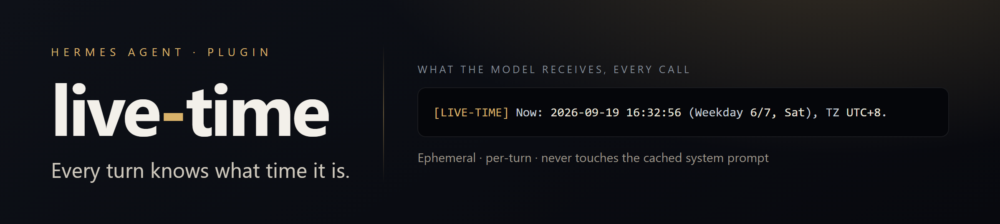

<p align="center">
  
</p>

<p align="center">
  <a href="https://github.com/NousResearch/hermes-agent/blob/main/plugin-catalog/live-time.yaml"></a>
  
  
  
  
  
</p>

<p align="center">
  <b>The agent always knows what time it is. Every turn. No tool call, no guessing.</b>
</p>

---

## The problem it kills

Hermes stamps `Conversation started: ...` **once**, when the session is created — and
never refreshes it. Keep one conversation going for a day or a week and the model is
quietly stuck at session-start time: it calls yesterday "today", misses that it's 3 a.m.,
and can't tell a five-minute reply from a two-day gap.

live-time re-injects the **real, current, timezone-aware time on every LLM call**, so
that whole class of confusion disappears. Tracking issue:
[#10421](https://github.com/NousResearch/hermes-agent/issues/10421).

**Before → after**, in an ordinary cross-day session:

```text
You        Let's keep going with option B.
Assistant  Sure — drafting the migration plan now.

          ······ you close the laptop; the session stays alive ······

You        OK, continue.

Assistant (without live-time)  Above, you said "today we'll finish" — so …
                               ← still convinced it's the same afternoon

Assistant (with live-time)     It's been about two days; picking up from option B,
                               here's the next step — and it's 11:40 p.m. your time,
                               so I'll keep this short.
```

## Install

**From the official catalog** (recommended):

```bash
hermes plugins install live-time --enable
hermes gateway restart        # the plugin loads on gateway start
```

**Straight from this repo:**

```bash
hermes plugins install chenfeijiang95-ui/hermes-live-time --enable
hermes gateway restart
```

**Manual (development):** drop the repository contents into
`<HERMES_HOME>/plugins/live-time/` and restart. No build step — it's plain Python.

**Verify in 5 seconds:** ask the agent *"what time is it right now?"* — it should answer
accurately without calling any tool. Or look for the injected marker in the request:

```text
[LIVE-TIME] Now: 2026-09-19 16:32:56 (Weekday 6/7, Sat), TZ UTC+8.
```

## What the model actually sees

One small, self-describing block, appended on the **user-message side** of every request:

```text
[LIVE-TIME] Now: 2026-09-19 16:32:56 (Weekday 6/7, Sat), TZ UTC+8.
Injected by live-time plugin at THIS LLM call's moment. Use THIS as the
authoritative current time for any today/now/elapsed/date judgment. Ignore
the 'Conversation started' timestamp in the system prompt for anything
except session-creation facts.
```

The wording is deliberate: the block claims authority over "now", and explicitly tells
the model to treat the session-start stamp as history rather than as the present.

## Design guarantees

| Guarantee | Why it matters |
|---|---|
| **Ephemeral** | Appended to the request only — never written into the cached system prompt, so **prompt caching is unaffected**. |
| **Read-only** | Touches no transcript, no memory store, no network. Nothing is persisted. |
| **Zero dependencies** | Standard library only. The runtime's YAML shim (`hermes_yaml`, ruamel-based) is used when importable, PyYAML otherwise — both optional. |
| **One guarded internal import** | `hermes_time._resolve_timezone_name`, wrapped in `try/except ImportError`, so a standalone copy still works. |
| **Fails open** | Unreadable config, unknown timezone, missing `zoneinfo` data → falls back to system-local time instead of raising. |
| **Single hook** | `pre_llm_call` and nothing else — one line in `register()`. |
| **Cheap** | A few string operations per turn. No I/O in the hot path. |

## Timezone resolution

Resolved fresh on each call, in this order:

1. `hermes_time._resolve_timezone_name()` — Hermes' own resolver, and the only source that
   knows the **routed profile** (see the multiplex caveat below). Guarded by
   `try/except`, so a standalone copy falls through to step 2.
2. `HERMES_TIMEZONE` environment variable
3. top-level `timezone` key in `<HERMES_HOME | ~/.hermes>/config.yaml`
   (parsed with `hermes_yaml.safe_load` inside a Hermes runtime, PyYAML elsewhere)
4. local system timezone (rendered as an offset, e.g. `TZ UTC+8`)

Weekday labels are English abbreviations (`Mon` … `Sun`) on purpose: the injected block
stays identical no matter what locale the rest of the conversation is in.

> **Multiplex caveat.** A host gateway serving several profiles does **not** export
> `HERMES_HOME` per routed profile: inside the gateway process it still points at the
> host's home (`~/.hermes`) while the session runs `profiles/<name>`. Reading the config
> file directly therefore resolves the *default* profile's `timezone` — usually unset —
> and the plugin silently falls back to system-local time. `HERMES_TIMEZONE` cannot cover
> this either, since one env value can only describe one profile. Step 1 exists for this:
> `hermes_time` resolves the profile that is actually answering.

## Troubleshooting

| Symptom | Likely cause |
|---|---|
| Agent still quotes a stale date | Plugin isn't loaded — run `hermes plugins list` (look for `live-time`, status *enabled*), then `hermes gateway restart`. |
| Time is right but the timezone is off | `HERMES_TIMEZONE` unset and `config.yaml` has no `timezone` key → it's using system-local. Set either one. |
| Timezone ignored for a specific profile | See the multiplex caveat above: the config file is the host's, not the routed profile's. Step 1 (`hermes_time`) is what fixes this. |
| Timezone ignored everywhere (`TZ UTC+8` while `config.yaml` sets one) | The runtime has no importable `hermes_time` *and* no YAML module (`hermes_yaml`/PyYAML), so only system-local time is available. |
| Nothing in the request at all | Another plugin or an older Hermes build. Check `hermes plugins doctor .` in the plugin directory. |

## Tests

```bash
pytest tests/test_live_time.py -v
```

Requires `pytest` in your environment.

Covers the injected-block shape, the timezone resolution order, and the invalid-timezone
fallback path.

## Links

- Upstream feature request: [hermes-agent#10421](https://github.com/NousResearch/hermes-agent/issues/10421)
- Catalog entry: [`plugin-catalog/live-time.yaml`](https://github.com/NousResearch/hermes-agent/blob/main/plugin-catalog/live-time.yaml)
- Submitted via [#114567](https://github.com/NousResearch/hermes-agent/pull/114567)
- In-tree plugin PR (open): [#85158](https://github.com/NousResearch/hermes-agent/pull/85158)

## License

MIT — see [LICENSE](LICENSE).
